\newpage

# Abstract {.unnumbered}

Large conditioned halls frequently suffer from uneven cooling: the air-handling capacity is adequate on paper, yet occupants report warm corners and stagnant zones that the supply air never reaches. This study isolates one controllable cause of that behaviour — the **supply-diffuser airflow pattern** — using transient computational fluid dynamics (CFD).

A 12 m × 10 m × 4 m hall (480 m³) served by two four-way ceiling cassettes is modelled in OpenFOAM (buoyantPimpleFoam, compressible, k–ω SST) under an identical cooling airflow of 1.81 m³/s (≈13.6 air changes per hour) and an identical 12 kW sensible heat load. Three supply patterns are compared at exactly the same air mass flow: a **baseline** 45° down-and-out four-way throw, a **swirl** (tangential) throw, and a **steep** (reduced-horizontal-throw) variant. The vertical supply component (−2.83 m/s) and the inlet area (0.64 m²) are held identical across all three, so the only variable is the horizontal direction of the supply jets.

The results show that airflow pattern — not capacity — governs whether the conditioned air actually reaches the occupied zone. At a matched 350 s of operation from a common initial state, the baseline holds the 24 °C setpoint with 89 % of the occupied zone comfortable, while the swirl and steep variants **short-circuit** supply air directly back into the central return, delivering only 6–8 kW of the available 12 kW of cooling and leaving the occupied zone 3–4 °C warmer. An energy-balance analysis confirms that all three patterns must ultimately reach the same return-air equilibrium (19.4 °C, 12 kW removed); they differ in how efficiently the air is used and how long and how hot the transient is. The exit (return) air temperature is identified as the single most diagnostic quantity, and the conventional Air Diffusion Performance Index (ADPI) is shown to be misleading when used alone, because it rewards a uniformly warm, draft-free zone.

\newpage

# 1. Introduction

## 1.1 Background

Ceiling cassettes are the dominant terminal unit for conditioning open halls, retail floors, and large living spaces, particularly in hot climates where sensible cooling loads are high for most of the year. A four-way cassette discharges supply air horizontally from four slots around a central return grille, relying on the Coanda effect and jet entrainment to spread cool air across the ceiling before it descends into the occupied zone. The arrangement is compact and architecturally unobtrusive, but it couples the supply and the return within the same 0.6 m footprint — which, as this study shows, makes it vulnerable to short-circuiting if the jet pattern is not well matched to the space.

## 1.2 Motivation

The practical observation that motivates this work is a common complaint in large rooms: *the air-conditioning does not reach every nook and corner.* The instinctive explanation is insufficient capacity. However, capacity (air mass flow and cooling kW) is only half of the story — the other half is **air distribution effectiveness**, i.e. whether the supplied cool air is delivered into the occupied zone and allowed to pick up the room's heat before it is exhausted, or whether it takes a shortcut back to the return without doing useful work. This study was designed to separate those two factors by holding capacity fixed and varying only the supply pattern.

## 1.3 Objectives and scope

The objectives are:

1. To quantify, at identical airflow and identical cooling load, how the supply-diffuser pattern affects occupied-zone temperature, temperature uniformity, draft, and comfort coverage.
2. To identify the physical mechanism (short-circuiting) and a practical diagnostic for it (the exit/return air temperature and the "short-circuit lag").
3. To establish the correct frame for comparison — a matched-time transient snapshot supported by an analytic steady-state energy balance — and to show why conservation laws do not require the three cases to share the same mean temperature at a given instant.

The scope is a single representative hall geometry, a single airflow and load, and three supply patterns, using Reynolds-averaged (RANS) turbulence modelling. Mesh-independence and reduced-airflow sensitivity are identified as follow-on work.

\newpage

# 2. Problem Setup and Design Considerations

## 2.1 Geometry

The modelled space is a rectangular hall of 12 m (x) × 10 m (y) × 4 m (z), a floor area of 120 m² and a volume of 480 m³. Two four-way ceiling cassettes are mounted flush with the ceiling at plan positions (3, 5) m and (9, 5) m, dividing the hall into two nominally symmetric halves (Figure 1).

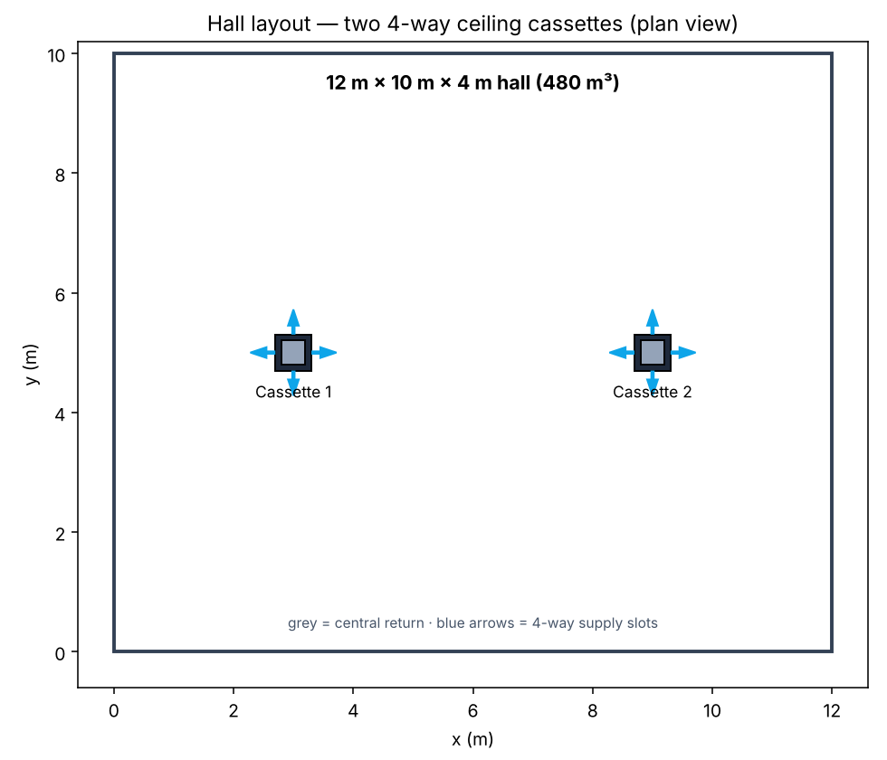{width=70%}

Each cassette occupies a 0.6 m × 0.6 m panel on the ceiling. The central 0.4 m × 0.4 m square is the **return (exhaust)** grille; the four surrounding slots (each 0.2 m × 0.4 m, 0.08 m²) are the directional **supply** outlets. The total supply area per cassette is 0.32 m², and 0.64 m² for the two cassettes combined. A cross-section through a cassette (Figure 2) shows the intended action: supply air is thrown down-and-out while the central grille extracts room air upward.

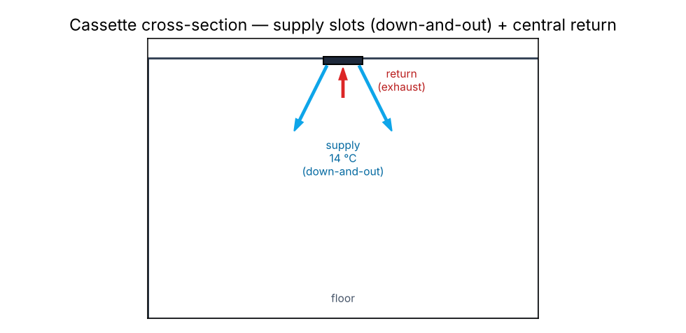{width=65%}

## 2.2 The three diffuser patterns

Three supply patterns are compared (Figure 3). In every case each slot discharges air with a fixed downward component of −2.83 m/s; the patterns differ only in the **horizontal** direction of the four jets:

- **A — Baseline (radial, 45° down-and-out):** each slot throws air outward, away from the cassette centre (east slot → +x, west → −x, north → +y, south → −y). This is the conventional four-way throw.
- **B — Swirl (tangential):** each slot throws air tangentially, so the four jets drive a coherent rotation about the cassette axis (a swirl diffuser action).
- **C — Steep (reduced horizontal throw):** the horizontal component is reduced from 2.83 m/s to 1.0 m/s, so the jets plunge more steeply downward with less lateral spread.

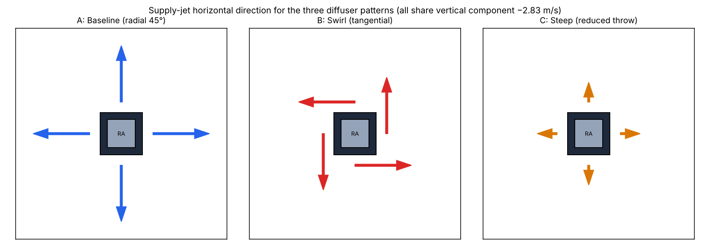{width=95%}

## 2.3 The controlled variable

The central design decision is that **cooling airflow is held constant across all three cases**. Because the supply slots lie flat on the ceiling, their outward normal is vertical, so only the vertical velocity component contributes to the volumetric flow through the face; the horizontal components are tangential to the opening and contribute nothing to the through-flow. Fixing the vertical component at −2.83 m/s and the area at 0.64 m² therefore fixes the volumetric flow at

$$\dot V = 0.64 \times 2.83 = 1.811~\text{m}^3/\text{s} \approx 13.6~\text{ACH},$$

and the mass flow at $\dot m = \rho \dot V = 1.229 \times 1.811 = 2.23~\text{kg/s}$, identical for A, B, and C. Note that the jet *speed* does differ (A and B: 4.0 m/s; C: 3.0 m/s), but this does not change the airflow, because only the normal component and area set the mass flow. This makes the supply pattern the single independent variable of the study.

\newpage

# 3. Numerical Model: Inputs and Boundary Conditions

## 3.1 Governing equations and solver

The simulations use OpenFOAM v2012 and the transient compressible buoyant solver **buoyantPimpleFoam**, which solves the Favre-averaged continuity, momentum, and energy (sensible enthalpy) equations for a compressible ideal gas under gravity. Turbulence is modelled with the two-equation **k–ω SST** RANS model. Air is treated as a perfect gas with constant transport properties (Table 1).

Table 1. Thermophysical and model inputs.

| Property | Value |
|---|---|
| Solver | buoyantPimpleFoam (transient, compressible) |
| Turbulence | k–ω SST (RANS) |
| Equation of state | Perfect gas, $M = 28.96$ kg/kmol ($R = 287.1$ J/kg·K) |
| Specific heat $c_p$ | 1004.4 J/kg·K |
| Dynamic viscosity $\mu$ | 1.831 × 10⁻⁵ Pa·s |
| Prandtl number | 0.705 |
| Gravity | 9.81 m/s² (−z) |

## 3.2 Computational mesh

The domain is discretised with a structured hexahedral mesh of **576,000 cells** (120 × 100 × 48 in x, y, z), with grading toward the ceiling to resolve the supply jets and the near-cassette shear layers. The four supply slots and the central return of each cassette are carved from the ceiling face as separate patches (8 supply faces and 16 return faces per cassette at the base cell size of 0.1 m × 0.1 m). The three cases use a byte-identical mesh, so geometry contributes nothing to the differences between them.

## 3.3 Boundary conditions

Table 2 summarises the boundary conditions. The supply velocity vector encodes the pattern (Section 2.2); the supply temperature is 14 °C (coil-off condition). The return is a pressure outlet. All solid walls (floor, ceiling, side walls) are no-slip and adiabatic — the adiabatic condition makes the internal heat source (Section 3.4) the sole thermal load, which is the cleanest way to isolate the diffuser effect.

Table 2. Boundary conditions.

| Patch | Velocity U | Temperature T | Pressure p_rgh |
|---|---|---|---|
| Supply slots | fixedValue (pattern, −2.83 m/s in z) | fixedValue 287.15 K (14 °C) | fixedFluxPressure |
| Return grille | pressureInletOutletVelocity | inletOutlet (297.15 K) | prghPressure (101325 Pa) |
| Floor / ceiling / walls | no-slip (0) | zeroGradient (adiabatic) | fixedFluxPressure |

## 3.4 Thermal load and thermostat approach

A uniform volumetric sensible heat source of **12 kW** is applied over the whole air volume using an `scalarSemiImplicitSource` fvOption (absolute mode, enthalpy). This represents a realistic hall sensible load of ~100 W/m² (occupants, lighting, envelope, solar) and plays the role of the load the cooling system must reject. With adiabatic walls, at steady state the entire 12 kW must leave with the return air, which fixes the equilibrium return temperature (Section 5.1) and lets the three patterns be compared against a common, physically meaningful setpoint target.

## 3.5 Numerical schemes and run strategy

Time integration is first-order Euler with an adaptive time step limited to a maximum Courant number of 10 (time step ≈ 0.02–0.07 s). The PIMPLE algorithm is used with the momentum predictor disabled and one outer corrector; convective terms use bounded `limitedLinear` schemes; density is bounded to the physical range [0.5, 2.0] kg/m³ (never active in practice). Each case was decomposed over four cores (hierarchical 2 × 2 × 1) and run in parallel. Return-grille and volume-mean temperatures were monitored every time step via function objects, and velocity/temperature fields were time-averaged over a late window for the comfort analysis. Cases were initialised from a uniform 24 °C quiescent state.

\newpage

# 4. Analysis Methodology

The time-averaged fields are sampled over the occupied zone (a 0.1–1.8 m height band, offset 0.3 m from the walls) on a regular grid, and the following metrics are computed.

**Energy balance / exit temperature.** For a control volume exchanging air through the supply and return only, with an internal source Q and adiabatic walls, the first law gives

$$\frac{dU}{dt} = \dot Q - \dot m\,c_p\,(T_\text{exit} - T_\text{supply}).$$

At steady state the left side is zero, fixing the exit (return) temperature. The cooling actually delivered at any instant is $\dot m\,c_p\,(T_\text{exit}-T_\text{supply})$, which makes the exit temperature the most direct measure of distribution effectiveness.

**ADPI (Air Diffusion Performance Index).** The effective draft temperature at each point is $\theta = (T_i - \bar T) - 8.0\,(V_i - 0.15)$, with $T$ in °C and $V$ in m/s. A point is "comfortable" when $-1.7 \le \theta \le 1.1$ and $V < 0.35$ m/s; ADPI is the percentage of occupied-zone points satisfying both. A design value above 80 is conventionally considered good.

**Draft Rating (DR, ISO 7730).** $DR = (34 - T_a)(V - 0.05)^{0.62}(0.37\,V\,Tu + 3.14)$, with turbulence intensity $Tu$ estimated from the modelled turbulent kinetic energy.

**Comfort coverage.** The percentage of the occupied zone within the absolute comfort band (23–26 °C and $V < 0.35$ m/s). Unlike ADPI, this penalises a room that is uniformly off-setpoint.

**Short-circuit lag.** The difference between the volume-mean temperature and the return temperature, $\bar T - T_\text{exit}$. A large lag indicates that the return is sampling cold, freshly supplied air (short-circuit) while the bulk of the room runs warm.

\newpage

# 5. Results and Discussion

## 5.1 Energy-balance validation

The mass flow and load fix the steady-state exit temperature independently of the pattern. With $\dot m = 2.227$ kg/s, $c_p = 1004.4$ J/kg·K, and $Q = 12$ kW:

$$T_\text{exit,eq} = T_\text{supply} + \frac{Q}{\dot m\,c_p} = 14 + \frac{12000}{2.227 \times 1004.4} = 19.4~^\circ\text{C}.$$

The baseline case, which reaches steady state within ~185 s, settles at an exit temperature of 19.2 °C — within 0.2 °C of the analytic value, validating the compressible energy balance and the mass flow. Crucially, **this equilibrium exit temperature is the same for all three patterns**: energy conservation requires it, because the return is the only path by which the 12 kW can leave the adiabatic domain. The patterns therefore cannot differ in their ultimate exit temperature or total cooling — they differ only in how quickly they reach it and how hot the occupied zone becomes along the way.

## 5.2 Transient behaviour

Figure 4 shows the volume-mean and exit temperatures versus time. The baseline flattens at the 24 °C setpoint almost immediately. The swirl and steep variants, by contrast, continue to climb: their exit air remains cold (16–18 °C), so they remove only part of the load and the room keeps heating. The swirl case had reached 31.5 °C (and was still rising) by 806 s of simulated time. Because these patterns short-circuit, their effective thermal time constant is very long, and their eventual equilibrium — while guaranteed to have an exit at 19.4 °C — corresponds to an uncomfortably warm occupied zone.

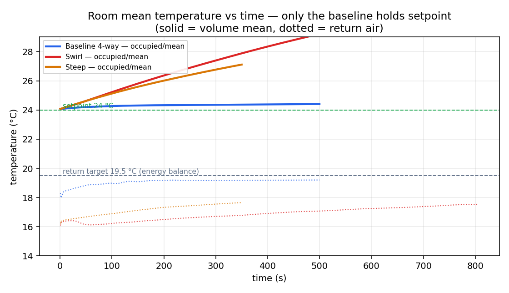{width=80%}

## 5.3 Exit (return) flow and the short-circuit mechanism

The exit temperature is the key to the whole comparison (Figure 5). The baseline exhausts warm air (~19 °C), meaning its supply air has mixed with the room and carried the room's heat to the grille — it removes 11.6 kW of the 12 kW load. The swirl and steep variants exhaust cold air (~17 °C): the supply is looping straight back into the central return without conditioning the room, so they remove only 6–8 kW. The near-ceiling flow fields (Figure 6) make the mechanism visible — in the swirl and steep cases cold (blue) air curls directly into the return grille, whereas in the baseline the returning air is warmer, having mixed with the occupied zone first.

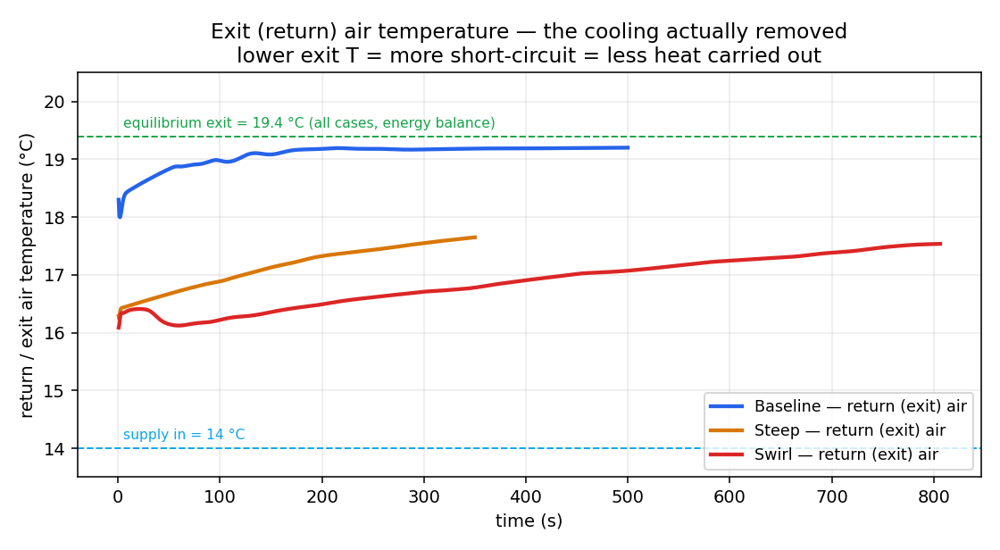{width=80%}

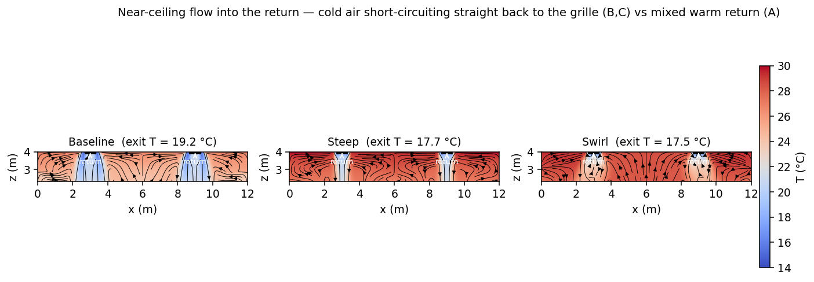{width=100%}

## 5.4 Why the mean temperature differs (open-system discussion)

A natural objection is that if mass, momentum, and energy are all conserved, the three cases should reach the same average temperature. The resolution is that the hall is an **open** flow system, not a closed one: it continuously exchanges energy with its surroundings through the supply and return. From the energy balance of Section 4,

$$\frac{dU}{dt} = \dot Q - \dot m\,c_p\,(T_\text{exit} - T_\text{supply}),$$

the source $\dot Q$, the mass flow $\dot m$, and the supply temperature $T_\text{supply}$ are identical across the three cases. The **only** term that differs is the exit temperature $T_\text{exit}$, which the flow pattern sets. A pattern that exhausts cold air (short-circuit) carries less heat out, so its room accumulates energy faster and runs warmer. Conservation guarantees that the books balance (accumulation = source − net outflow); it does not require the accumulated value to be the same when the outflow term differs. At true equilibrium, where all three share $T_\text{exit} = 19.4$ °C, the remaining difference appears as **stratification**: the return samples one location near the ceiling, so a short-circuiting, poorly mixed room can have a volume-mean well above its exit temperature.

## 5.5 Comfort coverage and the matched-time comparison

Figure 7 compares the three patterns at a matched 350 s of operation (the baseline is already at steady state by then). The comfort-coverage maps (Figure 8) show the practical outcome directly: green is within the comfort band, red is outside. The baseline fills the plan; the steep variant leaves gaps; the swirl is almost entirely out of band.

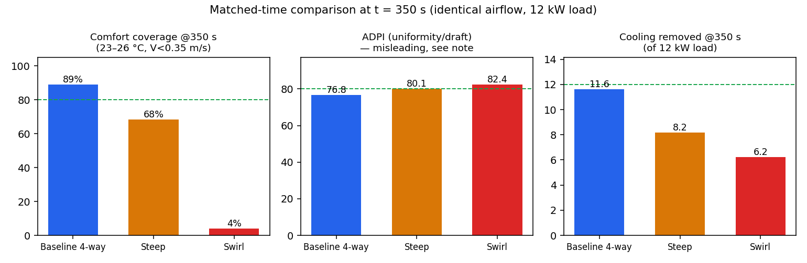{width=95%}

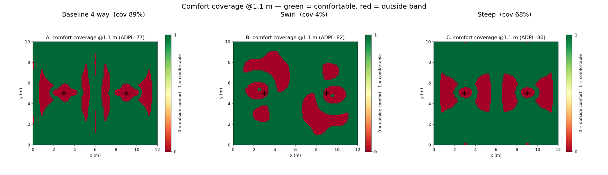{width=100%}

Table 3 collects the matched-time metrics. A critical caveat is visible in it: **ADPI is misleading if used alone.** The swirl case scores the *highest* ADPI (82) yet has the *lowest* comfort coverage (4 %). ADPI is computed relative to the *local* mean temperature, so a uniformly too-warm, dead-calm occupied zone scores well on uniformity and draft even though it is nowhere near setpoint. The absolute comfort coverage and the cooling-removed figure tell the true story and should drive the ranking.

Table 3. Matched-time comparison at t = 350 s (identical airflow and 12 kW load).

| Pattern | Occ. mean (°C) | Exit (°C) | Cooling removed (kW) | T std (°C) | ADPI | Coverage | Short-circuit lag (°C) |
|---|---|---|---|---|---|---|---|
| A — Baseline | 24.4 | 19.2 | 11.6 | 0.50 | 76.8 | 89 % | 5.2 |
| C — Steep | 27.1 | 17.7 | 8.2 | 0.43 | 80.1 | 68 % | 9.5 |
| B — Swirl | 27.9 | 16.8 | 6.2 | 0.37 | 82.4 | 4 % | 11.1 |

## 5.6 Field structure

The vertical temperature slices (Figure 9) and the three-dimensional streamline renderings (Figure 10) summarise the flow. The baseline distributes cool air broadly before it returns; the swirl keeps a cold rotating layer near the ceiling that feeds the return; the steep jets plunge but with limited lateral spread, leaving the periphery under-served.

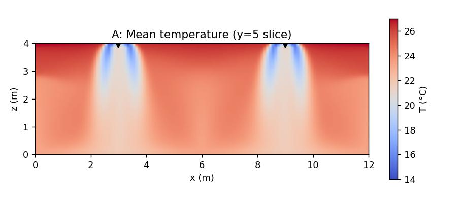{width=100%}

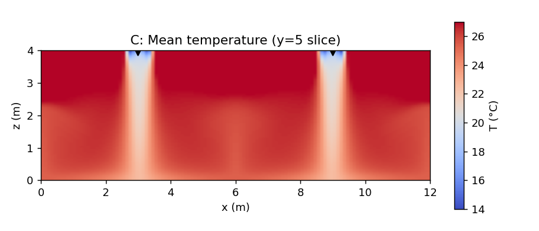{width=100%}

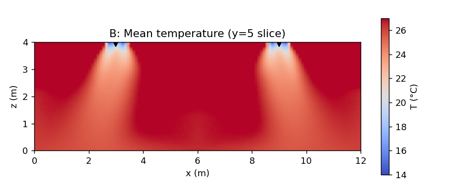{width=100%}

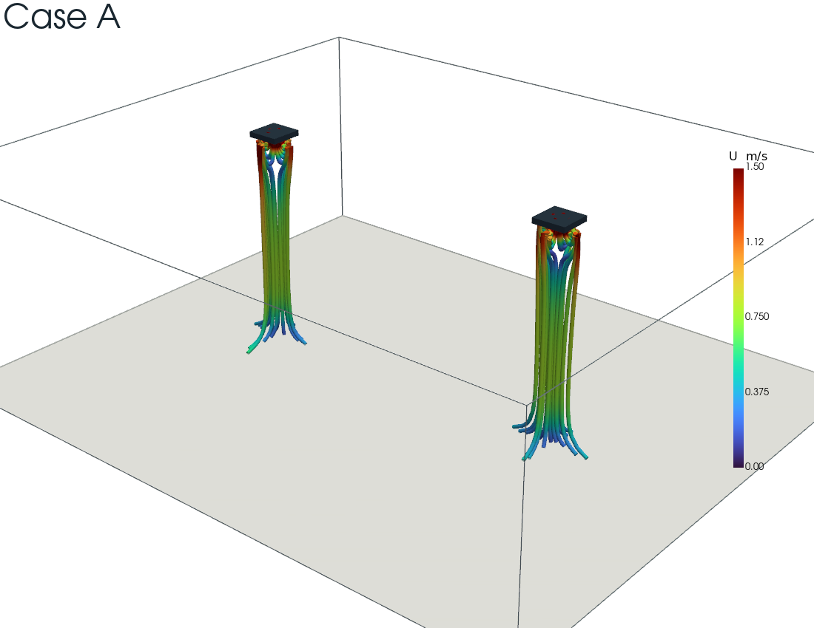{width=70%}

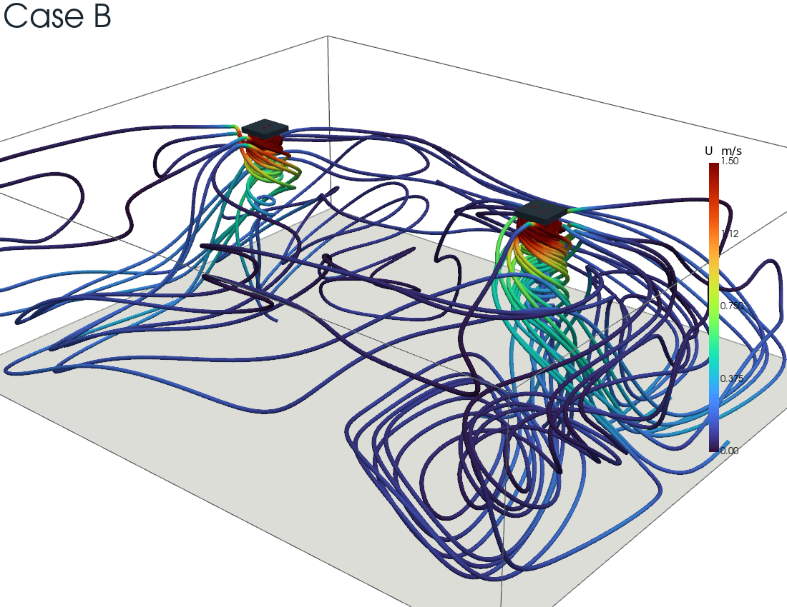{width=70%}

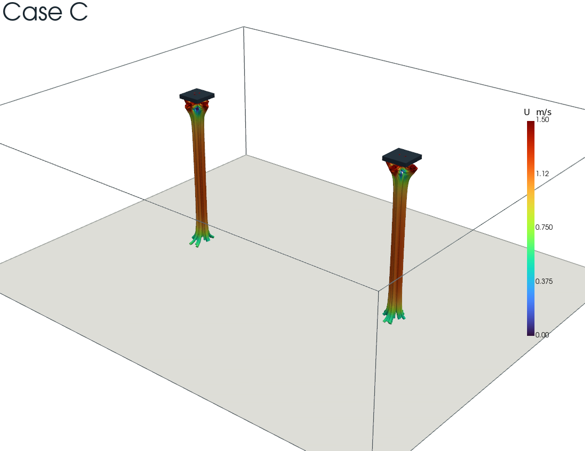{width=70%}

\newpage

# 6. Conclusions

1. **Airflow pattern, not capacity, decides coverage.** At identical cooling airflow (1.81 m³/s, 13.6 ACH) and identical 12 kW load, the baseline four-way throw holds the 24 °C setpoint with 89 % comfort coverage, while the swirl and steep variants leave the occupied zone 3–4 °C warmer with 4 % and 68 % coverage respectively. The supplied capacity was the same in every case; only its distribution differed.

2. **Short-circuiting is the mechanism, and the exit temperature is its diagnostic.** The baseline exhausts warm air (19 °C, 11.6 kW removed); the swirl and steep exhaust cold air (17 °C, 6–8 kW removed) because cool supply loops back into the co-located central return before conditioning the room. The short-circuit lag (mean − exit) of 5 °C, 9 °C, and 11 °C for baseline, steep, and swirl ranks the patterns cleanly.

3. **All patterns share the same energy-balance equilibrium.** Conservation fixes the steady exit at 19.4 °C and the cooling at 12 kW for all three; they differ in how fast they get there and how hot the room is meanwhile. The mean temperature can differ at a given instant precisely because the hall is an open system and the exit enthalpy flux is pattern-dependent.

4. **ADPI alone is a trap.** Because it is scored relative to the local mean, ADPI rewarded the worst-performing (swirl) pattern. Absolute comfort coverage and cooling-removed are the metrics that reflect real performance.

For this geometry, the conventional baseline four-way throw is clearly preferable; the swirl pattern is actively counter-productive when the return is co-located with the supply, and the steep pattern trades coverage for reduced lateral reach.

# 7. Limitations and Future Work

- **Transient truncation.** The comparison is a matched snapshot at 350 s. The baseline is at steady state; the swirl and steep cases were still approaching a hotter equilibrium and were not force-converged (their long thermal time constant makes full convergence expensive). Their reported values are an optimistic bound on their performance; their true equilibria are warmer still.
- **Single mesh.** A 576k-cell mesh was used throughout; a mesh-independence study on the baseline is the first recommended follow-up.
- **RANS turbulence.** The k–ω SST model represents the large-scale mixing in a time-averaged sense; it does not resolve the unsteady buoyant plumes, which a scale-resolving (LES/DES) model would.
- **Reduced-airflow case.** A lower-ACH variant is proposed to map the trade-off between coverage and air-change rate — directly addressing the original "insufficient capacity vs. poor distribution" question.

# Nomenclature {.unnumbered}

| Symbol | Meaning | Units |
|---|---|---|
| $\dot V$ | Volumetric supply flow | m³/s |
| $\dot m$ | Mass flow | kg/s |
| $Q$ | Sensible heat load | W |
| $c_p$ | Specific heat at constant pressure | J/kg·K |
| $T_\text{exit}$ | Return (exhaust) air temperature | °C |
| $\bar T$ | Volume-mean air temperature | °C |
| ADPI | Air Diffusion Performance Index | % |
| ACH | Air changes per hour | 1/h |
